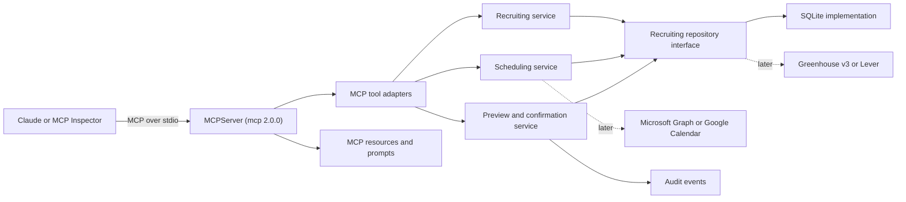

# Talent Ops MCP Server

## Phased Project Plan

**Document version:** 1.4  
**Prepared:** July 24, 2026 · **Revised:** August 21, 2026  
**Initial delivery model:** Local MCP server over stdio  
**Initial data source:** SQLite populated only with fictional recruiting data  
**Future integrations:** Greenhouse Harvest API v3 or Lever, plus Microsoft Graph or Google Calendar

---

## 0. Progress at a glance

| Phase | Status | Notes |
|---|---|---|
| 0 — Discovery, safety, contracts | ✅ Complete | SDK verified empirically; see `docs/reference/mcp-v2-verified-api.md` |
| 1 — Foundation and MCP handshake | ✅ Complete | All gates green: ruff, mypy, 41 passed / 1 skipped, `uv build` |
| 2 — SQLite schema, repository, seed | ✅ Complete | 13 tables, 83-row deterministic seed; gates green: 129 passed / 1 skipped |
| 3 — Read-only recruiting tools | ✅ Complete | 4 read tools, cursor pagination; gates green: 230 passed / 1 skipped, `uv build` |
| 4 — Deterministic scheduling engine | ✅ Complete | 1 compute tool, 8 no-slot reasons; gates green: 350 passed / 1 skipped, `uv build` |
| 5 — Preview and confirmed scheduling | ⬜ Not started | Next |
| 6 — Reporting, resources, prompts | ⬜ Not started | |
| 7 — Security and quality hardening | ⬜ Not started | |
| 8 — Claude and Inspector integration | ⬜ Not started | |
| 9 — Calendar provider integration | ⬜ Deferred | Post-MVP |
| 10 — ATS integration | ⬜ Deferred | Post-MVP |
| 11 — Remote and production readiness | ⬜ Deferred | Requires security approval |

### Revision 1.1 changes (August 6, 2026)

Three things in v1.0 turned out to be wrong or unavailable and are corrected below:

1. **The SDK.** `mcp` 2.0.0 went GA on 2026-07-28, four days after this plan was written.
   `FastMCP` does not exist in v2. §5.2 and §5.3 are rewritten; the binding reference is
   `docs/reference/mcp-v2-verified-api.md`, every claim in which was produced by running
   code on this machine.
2. **Naming.** The project is `talent-ops-mcp` / package `talent_ops_mcp`, and the
   configuration prefix is `TALENT_OPS_`, not `RCMCP_`. §6.2 and §15 updated.
3. **Tool names.** `/mcp-builder` was installed mid-session and read in full. It found one
   binding issue: no tool name carried a service prefix, so `health_check` in particular would
   collide with another MCP server in the same client. Every tool is renamed
   `talent_ops_{action}_{resource}` under the escape hatch in `PROMPT.md` §9. Adopted standards
   are in §7.1.1; deliberate deviations, including the skill's v1/FastMCP syntax that cannot be
   used on 2.0.0, are in §7.1.2. One new deliverable came from it — an evaluation set, added to
   Phase 6.

---

## 1. Executive Summary

This project will create a Python Model Context Protocol (MCP) server that lets an AI assistant coordinate recruiting operations through a small, explicit set of tools and resources.

The server will support administrative workflows such as:

- Finding open jobs and active applications.
- Identifying candidates who are awaiting interview scheduling.
- Retrieving the approved interview plan for a job and stage.
- Finding compatible candidate and interviewer availability.
- Proposing several valid interview times.
- Preparing an exact scheduling preview.
- Recording an interview only after human confirmation.
- Reporting upcoming interviews and overdue feedback.
- Maintaining an audit trail for state-changing operations.

The server will not score, rank, recommend, hire, or reject candidates. It will not infer protected characteristics or use AI output as an employment decision. Keeping the system focused on coordination makes the project more useful, testable, and defensible.

Development will proceed from a fully local, synthetic-data MVP to optional real calendar and applicant-tracking-system integrations. Each phase has an explicit completion gate. A phase is complete only when its implementation, tests, and documentation pass.

---

## 2. Product Boundary

### 2.1 In scope

- Recruiting logistics and pipeline administration.
- Read-only job, candidate, application, and interview-plan retrieval.
- Availability calculation and interview-slot proposals.
- Interview preview and human-confirmed scheduling.
- Interview rescheduling and cancellation in later phases.
- Candidate and interviewer communication drafts.
- Upcoming-interview and overdue-feedback reports.
- Policy and template resources for AI clients.
- Local audit logging.
- Later integration with a real ATS and calendar provider.

### 2.2 Explicitly out of scope

- Candidate ranking, scoring, or comparison.
- “Culture fit,” personality, emotion, or sentiment evaluation.
- Automatic hiring, rejection, or promotion decisions.
- Inferring race, ethnicity, sex, gender identity, religion, disability, age, pregnancy, national origin, veteran status, genetic information, or other protected information.
- Using names, photographs, addresses, graduation dates, or proxies for protected traits in decisions.
- Unrestricted SQL execution.
- Arbitrary filesystem access.
- Arbitrary HTTP requests.
- Sending real messages during the local MVP.
- Connecting to production recruiting systems during early phases.
- Storing real candidate data in development fixtures.

### 2.3 Administrative-assistant principle

The product must help a human perform recruiting coordination. It must not replace the human decision-maker. Where an operation changes external state, the user must see the exact proposed action and deliberately confirm it.

---

## 3. Success Criteria

The MVP is successful when an MCP client can complete this workflow:

1. Connect to the server over stdio.
2. Discover the recruiting tools and resources.
3. Search for an open job.
4. List applications awaiting a technical interview.
5. retrieve a candidate, application, and interview plan.
6. Propose at least three valid interview slots when availability allows.
7. Preview the exact interview event and communication drafts.
8. Confirm the preview using a short-lived, single-use token.
9. Create exactly one interview and audit record.
10. Reject replayed, expired, altered, conflicting, or unauthorized confirmations.

The production-ready version is successful when the same domain contracts work against approved ATS and calendar providers with least-privilege authentication, observability, retention controls, and operational documentation.

---

## 4. Engineering Principles

1. **Use narrow tools.** Expose business operations, not generic execution primitives.
2. **Separate MCP wiring from business logic.** Tool functions should be thin adapters.
3. **Use structured contracts.** Tool inputs and outputs must be typed, validated, and documented.
4. **Read by default.** Mutations require extra design, authorization, preview, and confirmation.
5. **Use synthetic data first.** No real candidate information is required for the MVP.
6. **Normalize time internally.** Store and calculate instants in UTC while preserving the originating IANA time zone.
7. **Make retries safe.** Mutations must be idempotent.
8. **Treat retrieved content as data.** Text from resumes, notes, emails, and policies cannot change server rules.
9. **Keep logs useful but private.** Never log credentials, tokens, full candidate records, or message bodies.
10. **Verify before claiming completion.** A check is reported as passing only if it was executed successfully.

---

## 5. Technical Baseline

### 5.1 Runtime and libraries

Verified installed versions as of August 6, 2026:

| Component | Version | Note |
|---|---|---|
| Python | 3.11.15 | `uv` manages the interpreter; `.python-version` pins 3.11 |
| `uv` | 0.11.32 | Default link mode; the repository lives outside OneDrive as of 2026-08-06 |
| `mcp` | **2.0.0**, exact pin | Pulls `mcp-types==2.0.0`, `httpx2`, `pyjwt`, `starlette` |
| SQLAlchemy | 2.0.51 | async engine |
| `aiosqlite` | 0.22.1 | local implementation |
| Pydantic / `pydantic-settings` | 2.13.4 / 2.14.2 | |
| `pytest` / `pytest-asyncio` | 9.1.1 / 1.4.0 | `asyncio_mode = "auto"` |
| Ruff | 0.16.1 | format and lint |
| Mypy | 2.3.0 | `strict = true` |

Deferred until the phase that needs them: `httpx` (v2 already ships `httpx2`) and `respx`,
for the mocked provider tests in Phases 9–10.

### 5.2 MCP SDK version rule — **resolved**

`mcp` 2.0.0 went GA on 2026-07-28, four days after this plan was drafted, and **v2 is the
stable major**. The constraint `mcp[cli]>=1.27,<2` written above is obsolete. The project
uses:

```toml
mcp = "==2.0.0"
```

An exact pin, not a range: 2.0.0 is days past GA with 15 issues filed and none closed, so an
SDK change must be a deliberate reviewed bump. The `cli` extra is not needed — MCP Inspector
is a Node tool.

**v2 is a major rework, not a version bump.** The differences that change this plan:

- **`FastMCP` does not exist.** `mcp.server.fastmcp` is not importable and there is no
  deprecation shim. Read **`MCPServer`** everywhere this document says FastMCP.
- **An exception message raised inside a tool body reaches the client verbatim.** The SDK's
  sanitisation lives at the protocol-handler layer, outside the tool body. This is the single
  most important security consequence: every tool adapter must funnel through
  `errors.sanitized()`.
- **Wire model fields are snake_case** (`input_schema`, `is_error`, `structured_content`,
  `next_cursor`).
- **The SDK no longer reads `MCP_*` or `.env`.** All configuration is ours.
- **Sync handlers run on a worker thread** and cannot reach the event loop, so every handler
  touching the database must be `async def`.
- **A static resource may not declare a `Context` parameter** — it fails at *import*. The four
  static policy/template resources therefore have no route to the database and must be served
  from module constants.

The binding reference is `docs/reference/mcp-v2-verified-api.md`, with re-runnable probes in
`docs/reference/probes/`. Never combine v1 and v2 imports, decorators, client patterns, or
transport APIs.

### 5.3 Initial transport

Use stdio for the local server:

- Standard output is reserved for MCP protocol traffic.
- Application logging goes to standard error.
- No banner, diagnostics, or `print()` output may corrupt stdout.
- The server runs as a console script (`talent-ops-mcp`) and as a Python module
  (`python -m talent_ops_mcp`).

v2 hardens this for us: `stdio_server()` claims file descriptors 0 and 1, serves from a
private duplicate, and diverts anything written to the original stdout to stderr. That is a
safety net, not a licence — output flushed *before* serving begins, or buffered until
interpreter exit, still lands on the wire. **Never call `print()`; emit nothing at import
time; never add a `StreamHandler(sys.stdout)`.**

Constructing an `MCPServer` calls `logging.basicConfig()` itself, and `basicConfig()` never
replaces existing handlers, so `logging_config.configure_logging()` must run **before** the
server is constructed or the SDK's handler wins.

Streamable HTTP is deferred until a real remote deployment is justified.

---

## 6. Target Architecture



### 6.1 Layer responsibilities

| Layer | Responsibility |
|---|---|
| MCP server | Server metadata, instructions, lifecycle, registration, and transport |
| Tool adapters | Validate MCP input, call services, translate domain errors |
| Resources/prompts | Expose approved policies, templates, and guided workflows |
| Services | Recruiting rules, scheduling, confirmation, and auditing |
| Repository interfaces | Provider-neutral contracts for jobs, candidates, applications, and interviews |
| SQLite repository | Local deterministic implementation with fictional data |
| Provider adapters | Future Greenhouse, Lever, Microsoft Graph, or Google integrations |

### 6.2 Proposed repository layout

`✅` exists as of Phase 1; everything else is created by the phase that needs it.

```text
talent-ops-mcp/
├── pyproject.toml                       ✅
├── uv.lock                              ✅
├── .python-version                      ✅
├── README.md                            ✅
├── PLAN.md  PROMPT.md                   ✅
├── docs/reference/                      ✅  verified SDK API + re-runnable probes
├── SECURITY.md                              Phase 7
├── LICENSE                                  Phase 8
├── .env.example                         ✅
├── .gitignore                           ✅
├── scripts/
│   └── seed_demo_data.py             ✅
├── src/
│   └── talent_ops_mcp/
│       ├── __init__.py                  ✅
│       ├── __main__.py                  ✅
│       ├── server.py                    ✅
│       ├── settings.py                  ✅
│       ├── logging_config.py            ✅
│       ├── errors.py                    ✅
│       ├── models/                      ✅   domain, outputs (no `inputs`: see Phase 3 notes)
│       ├── db/                          ✅   base, schema, session, seed
│       ├── repositories/                ✅   protocols, sqlite
│       ├── services/                    ✅   pagination, recruiting; scheduling + confirmation Phase 4-5
│       ├── tools/                       ✅   recruiting; reporting Phase 6
│       ├── resources/                        Phase 6     policies, templates
│       └── prompts/                          Phase 6     workflows
└── tests/
    ├── conftest.py                       ✅
    ├── unit/                             ✅  settings, errors, logging, pagination, intervals
    ├── contract/                         ✅  in-process MCP client
    ├── integration/                      ✅  schema, seed, repositories, recruiting service
    ├── fixtures/                             not created — its contents are pytest fixtures,
    │                                         which belong in conftest.py (Revision 1.2 note 4)
    └── test_mcp_smoke.py                 ✅  real stdio subprocess
```

Avoid empty modules created only for appearance. Add a module when it has a clear responsibility.

Phase 1 deliberately did not create the `models/`, `db/`, `tools/`, `resources/`, or `prompts/`
packages: `health_check` and its output model live in `server.py` until Phase 3 gives them
company. `errors.py` earns its place immediately because `health_check` is already a tool and
must not leak an exception message.

---

## 7. Initial MCP Surface

### 7.1 Tools

**Names revised August 6, 2026** under the hook in `PROMPT.md` §9 ("implement the following
names unless the installed `/mcp-builder` skill identifies a binding compatibility issue").
The skill identified one: none of the original names carried a service prefix, so
`health_check` — and to a lesser degree the rest — would collide the moment this server ran
beside another in the same client, leaving the model unable to tell which server it was
calling. Every tool is now `talent_ops_{action}_{resource}`: prefixed, and action-first so the
name reads as the thing it does. A contract test asserts the prefix on *every* registered
tool, so a later phase cannot reintroduce an unprefixed name.

| Tool | Phase | Type | Purpose |
|---|---:|---|---|
| `talent_ops_health_check` | 1 ✅ | Read | Confirm server readiness and report non-sensitive version information |
| `talent_ops_search_jobs` | 3 ✅ | Read | Search open or closed jobs using bounded filters |
| `talent_ops_list_applications` | 3 ✅ | Read | List applications by job, stage, status, or scheduling need |
| `talent_ops_get_candidate` | 3 ✅ | Read | Retrieve one candidate and relevant application context |
| `talent_ops_get_interview_plan` | 3 ✅ | Read | Retrieve approved duration, panel, skill, and scheduling rules |
| `talent_ops_propose_interview_slots` | 4 ✅ | Compute/read | Calculate compatible slots without changing state |
| `talent_ops_preview_interview_schedule` | 5 | Local preview | Create an exact, expiring proposal and confirmation token |
| `talent_ops_confirm_interview_schedule` | 5 | Mutation | Atomically create one interview from an unchanged valid preview |
| `talent_ops_list_upcoming_interviews` | 6 | Read | Report upcoming interviews using bounded date filters |
| `talent_ops_list_overdue_feedback` | 6 | Read | Report missing feedback without evaluating candidates |

Later tools, same convention:

- `talent_ops_preview_interview_reschedule` / `talent_ops_confirm_interview_reschedule`
- `talent_ops_preview_interview_cancel` / `talent_ops_confirm_interview_cancel`
- `talent_ops_draft_candidate_email`
- `talent_ops_preview_feedback_reminder` / `talent_ops_send_feedback_reminder`

Sending and cancellation remain disabled until provider authorization, audit, and confirmation requirements are complete.

### 7.1.1 Tool contract standards (from `/mcp-builder`)

Binding on every tool from Phase 3 onward:

- **Prefix.** `talent_ops_` on every name, enforced by a contract test.
- **All four annotations** set explicitly: `read_only_hint`, `destructive_hint`,
  `idempotent_hint`, `open_world_hint`. `open_world_hint` is `False` while the only backend is
  local SQLite and **must flip to `True`** for any tool that reaches a calendar or ATS in
  Phases 9–10.
- **Descriptions state when *not* to use the tool**, not only when to use it. A description
  with a "Use when:" but no "Do not use:" is incomplete; a test asserts both on
  `talent_ops_health_check` and the same standard applies to the rest.
- **Errors are actionable.** A failure or degraded result names the next step the caller can
  take, using environment-variable names and identifiers rather than paths. See
  `DEGRADED_DETAIL` in `server.py` for the shape.
- **Pagination metadata.** Every list tool returns `total`, `count`, `has_more`, and
  `next_cursor` — not just items and a cursor. `has_more` and `total` were added on the skill's
  recommendation; cursor-based paging is kept over `offset` because it stays correct when rows
  are inserted between pages, and the skill accepts `next_cursor` as an alternative to
  `next_offset`.

### 7.1.2 Deliberate deviations from `/mcp-builder`

Recorded so they read as decisions rather than oversights.

| Skill guidance | Decision | Why |
|---|---|---|
| `from mcp.server.fastmcp import FastMCP`, `FastMCP("service_mcp")`, `annotations={"readOnlyHint": ...}` dict, `ctx.log_info`, `ctx.request_context.lifespan_state`, `TypedDict` returns, `mcp.run(transport="streamable_http")` | **Not used** | All are v1 idiom. `mcp.server.fastmcp` is not importable in 2.0.0; annotations are `ToolAnnotations(read_only_hint=...)`; the logging capability is deprecated (SEP-2577); the attribute is `lifespan_context`; `TypedDict` hits SDK issues #3224/#3227. §5.2 forbids mixing eras. The skill's *design principles* are followed throughout. |
| Every data tool accepts `response_format: markdown \| json` | **Not implemented** | Superseded by v2 structured output: a Pydantic return annotation already yields `structured_content` *plus* a JSON text block, so the machine-readable half is native. One annotated function cannot also return a markdown string without giving up the auto-generated `output_schema`, and the parameter would double the input surface on nine tools. Revisit only if token cost on large result sets measurably hurts. |
| Server name `{service}_mcp` | **Followed** — `talent_ops_mcp` | The distribution and console script stay hyphenated (`talent-ops-mcp`), which is PyPI and CLI convention. Only the protocol-advertised name uses underscores. |
| Comprehensive docstrings restating the full output schema in prose | **Partially** | The "Use when / Do not use" and return summary are kept because they carry real signal. The field-by-field schema is not restated: v2 generates `output_schema` from the Pydantic model, and duplicating it in prose invites the two to drift — which the skill's own DRY principle argues against. |
| Build evaluations (skill Phase 4) | **Adopted as a new deliverable** | Neither `PLAN.md` 1.0 nor `PROMPT.md` mentioned it. Added to Phase 6 — see §12. |

### 7.2 Resources

| Resource URI | Purpose |
|---|---|
| `recruiting://policies/scheduling` | Working hours, buffers, lead time, and scheduling restrictions |
| `recruiting://policies/candidate-communication` | Approved communication and privacy rules |
| `recruiting://templates/interview-invitation` | Candidate invitation template |
| `recruiting://templates/rescheduling` | Candidate rescheduling template |
| `recruiting://jobs/{job_id}/interview-plan` | Addressable approved plan for a job |

### 7.3 Prompts

| Prompt | Purpose |
|---|---|
| `schedule_candidate_interview` | Guide a user through lookup, proposal, preview, and confirmation |
| `prepare_interview_day` | Summarize logistics for upcoming interviews without candidate evaluation |
| `review_pipeline_delays` | Identify administrative bottlenecks and missing coordination work |

Prompts keep their unprefixed names from `PROMPT.md` §15. `/mcp-builder`'s prefix rule is about
*tools*, where the model auto-selects and a collision is silently wrong. Prompts live in a
separate namespace and a human picks one deliberately from a menu, so the collision cost is a
duplicate menu entry rather than a misrouted call.

---

## 8. Domain and Data Model

### 8.1 Core entities

**Job**

- `id`
- `title`
- `department`
- `location`
- `default_timezone`
- `status`
- `created_at`
- `updated_at`

**Candidate**

- `id`
- `first_name`
- `last_name`
- `email`
- `phone` (optional)
- `timezone`
- `preferred_contact_method`
- `created_at`
- `updated_at`

**Application**

- `id`
- `candidate_id`
- `job_id`
- `current_stage`
- `status`
- `coordinator_id`
- `last_activity_at`
- `created_at`
- `updated_at`

**InterviewPlan**

- `id`
- `job_id`
- `stage`
- `interview_type`
- `duration_minutes`
- `panel_size`
- `minimum_lead_hours`
- `buffer_before_minutes`
- `buffer_after_minutes`
- `working_hours_policy`
- `active`

**InterviewPlanSkillRequirement**

- `interview_plan_id`
- `skill_code`
- `minimum_interviewers`

**Interviewer**

- `id`
- `name`
- `email`
- `timezone`
- `active`

**InterviewerSkill**

- `interviewer_id`
- `skill_code`

**AvailabilityWindow**

- `id`
- `owner_type`
- `owner_id`
- `start_utc`
- `end_utc`
- `source`

**Interview**

- `id`
- `application_id`
- `interview_plan_id`
- `start_utc`
- `end_utc`
- `display_timezone`
- `status`
- `external_event_id` (nullable)
- `idempotency_key`
- `created_at`

**InterviewAttendee**

- `interview_id`
- `attendee_type`
- `attendee_id`
- `response_status`

**FeedbackRequest**

- `id`
- `interview_id`
- `interviewer_id`
- `due_at`
- `submitted_at` (nullable)
- `status`

**ActionPreview**

- `id`
- `operation`
- `actor_id`
- `payload_json`
- `payload_hash`
- `token_hash`
- `expires_at`
- `used_at` (nullable)
- `status`
- `created_at`

**AuditEvent**

- `id`
- `request_id`
- `actor_id`
- `action`
- `target_type`
- `target_id`
- `result`
- `metadata_json`
- `created_at`

### 8.2 Data handling rules

- All demo identities are fictional and use `.test` email domains.
- Datetimes stored in the database are UTC and timezone-aware.
- User-facing output includes an explicit IANA timezone.
- Candidate searches are paginated and bounded.
- Sensitive candidate fields are returned only when required by the tool.
- Free-form notes are excluded from the MVP to reduce accidental sensitive-data exposure.
- Database constraints enforce uniqueness, referential integrity, and valid status values.
- Seed generation is deterministic so tests remain reproducible.

---

## 9. Scheduling Rules

The scheduling engine is deterministic application logic, not model reasoning.

### 9.1 Inputs

- Application and approved interview plan.
- Candidate availability windows.
- Eligible interviewers and their skills.
- Interviewer availability windows.
- Existing interview conflicts.
- Date range requested by the user.
- Candidate display timezone.
- Working-hours policy.
- Duration and buffers.
- Minimum lead time.
- Maximum number of returned options.

### 9.2 Algorithm

Implemented in `services/scheduling.py` (Phase 4). Steps 4-8 are the interval algebra at the top
of that module; steps 9-12 are `select_panel` and the scan below it.

1. Validate that the application is active and at the expected stage.
2. Resolve the active interview plan.
3. Select active interviewers capable of satisfying all skill requirements.
4. Normalize all availability windows to UTC.
5. Subtract existing commitments plus before/after buffers.
6. Intersect candidate and eligible-panel availability.
7. Divide remaining windows on a configured interval, initially 15 minutes.
8. Enforce minimum lead time and working-hours policies.
9. Construct valid interviewer combinations that cover the skill requirements.
10. Deduplicate equivalent proposals.
11. Sort deterministically by earliest time, required coverage, and minimal fragmentation.
12. Return no more than the requested bounded maximum.

### 9.3 Scheduling invariants

- End time must be later than start time.
- Every selected interviewer must be available for the full interval plus required buffers.
- Required skills and panel size must be satisfied.
- No attendee can have an overlapping active interview.
- Proposed options do not reserve availability.
- Confirmation repeats the conflict check inside the write transaction.
- Candidate time is never interpreted without an IANA timezone.
- Ambiguous or nonexistent local times around daylight-saving transitions are rejected or explicitly resolved.

---

## 10. Preview and Confirmation Protocol

High-impact state changes use a two-step protocol.

### 10.1 Preview

`talent_ops_preview_interview_schedule`:

1. Revalidates the application, plan, slot, and attendees.
2. Constructs the complete immutable operation payload.
3. Produces the event title, description, attendees, start/end, timezone, and draft communications.
4. Canonically serializes the payload.
5. Computes a SHA-256 payload hash.
6. Generates a cryptographically random token with at least 256 bits of entropy.
7. Stores only the token hash.
8. Sets a short expiration, initially 10 minutes.
9. Writes a preview audit event.
10. Returns the exact preview plus the plaintext token once.

### 10.2 Confirmation

`talent_ops_confirm_interview_schedule`:

1. Hashes the presented token and loads the matching preview.
2. Verifies operation type, actor, expiration, unused status, and payload hash.
3. Rechecks application state, interviewer eligibility, and conflicts.
4. Opens a transaction.
5. Creates the interview using a unique idempotency key.
6. Creates attendees and feedback requests.
7. Marks the preview used.
8. Writes the success audit event.
9. Commits atomically.
10. Returns the created interview.

### 10.3 Failure behavior

- Invalid tokens return a generic controlled error.
- Expired tokens require a fresh preview.
- Used tokens return the existing result when safely identifiable or an explicit replay error.
- Changed application state invalidates the preview.
- New calendar conflicts invalidate the preview.
- Partial writes must roll back.

---

## 11. Error Model

Use stable, sanitized error codes:

| Code | Meaning |
|---|---|
| `VALIDATION_ERROR` | Input failed schema or domain validation |
| `NOT_FOUND` | Requested entity does not exist in the allowed scope |
| `CONFLICT` | State changed or a scheduling conflict exists |
| `UNAUTHORIZED` | Authentication is missing or invalid |
| `FORBIDDEN` | Actor lacks permission for the operation |
| `PREVIEW_EXPIRED` | Confirmation preview has expired |
| `PREVIEW_ALREADY_USED` | Confirmation token was replayed |
| `UNSAFE_OPERATION` | Request violates the administrative-assistant boundary |
| `UPSTREAM_TIMEOUT` | Approved provider did not respond in time |
| `UPSTREAM_UNAVAILABLE` | Approved provider is unavailable |
| `INTERNAL_ERROR` | Unexpected failure with no sensitive detail returned |

MCP responses must never contain:

- Stack traces.
- Database connection strings.
- API keys or authorization headers.
- Raw provider responses containing unrelated records.
- Internal filesystem paths unless explicitly needed for local setup diagnostics.

---

## 12. Phase Plan

## Phase 0 — Discovery, Safety, and Contracts ✅

### Objective

Freeze the product boundary, tool contracts, version baseline, and acceptance criteria before implementation.

### Tasks

- [x] Inspect repository and instruction files.
- [x] Invoke and follow the installed Claude `/mcp-builder` skill. **Done** — the skill was
      installed mid-project (`example-skills@anthropic-agent-skills`) and read in full, along with
      its `mcp_best_practices.md` and `python_mcp_server.md` references. Its design principles are
      adopted; its v1/FastMCP syntax is not, and cannot be, since `mcp.server.fastmcp` does not
      exist in 2.0.0. Findings, adopted standards, and deliberate deviations are recorded in §7.1.1
      and §7.1.2. The one binding change it produced: **every tool is renamed with a
      `talent_ops_` prefix**, under the escape hatch `PROMPT.md` §9 provides for exactly this.
      Empirical SDK verification (`docs/reference/mcp-v2-verified-api.md` and the probes beside it)
      remains the authority on *syntax*, because the skill's is a version behind.
- [x] Verify the current stable MCP Python SDK and supported syntax — **`mcp` 2.0.0 is stable;
      `FastMCP` no longer exists**. See §5.2.
- [x] Record the selected Python and SDK versions — §5.1 table.
- [x] Create a tool inventory with read/mutation classification — §7.1.
- [x] Finalize entities, enums, error codes, and result models — §8, §11. `ErrorCode` is implemented
      in `errors.py` with a test asserting the set matches this document exactly.
- [x] Document the prohibited employment-decision behavior — §2.2, and enforced in the server
      `INSTRUCTIONS` string, asserted by a contract test.
- [ ] Create initial threat model — **deferred to Phase 7**, which owns the complete one. The
      Phase 1 surface (one read-only tool, no candidate data) does not yet have threats to model
      beyond stdout corruption and error leakage, both of which are already tested.
- [x] Decide configuration names and safe defaults — §15, implemented in `settings.py`.
- [x] Write an implementation decision record for stdio and SQLite — §5.2, §5.3.

### Deliverables

- [x] Architecture summary — §6, and README "Architecture".
- [x] Final tool-contract table — §7.1.
- [x] Data model — §8.
- [ ] Threat model — Phase 7.
- [x] Dependency plan — §5.1, locked in `uv.lock`.
- [x] Phase-by-phase working checklist — this document, §0 for the summary.

### Completion gate

- [x] No unresolved ambiguity about candidate ranking or decision-making.
- [x] Every MVP tool has a defined input, output, side effect, and error set.
- [x] Current SDK syntax has been verified — **by execution, not by reading docs**.

---

## Phase 1 — Project Foundation and MCP Handshake ✅

**Completed August 6, 2026.**

### Objective

Produce an installable Python package with a working stdio MCP server.

### Tasks

- [x] Initialize `uv` package — `pyproject.toml`, `uv.lock`, `.python-version`, hatchling backend.
- [x] Add runtime and development dependencies — `mcp==2.0.0` exact; dev group via PEP 735.
- [x] Configure Ruff, Mypy, and Pytest — Ruff with `DTZ`/`S`/`ANN` selected and `TC` deliberately
      excluded (it breaks the SDK's runtime introspection); Mypy `strict = true`;
      `asyncio_mode = "auto"`.
- [x] Implement validated settings — `settings.py`, with database-path containment inside
      `data_dir` including symlink resolution.
- [x] Implement stderr logging with request correlation — `logging_config.py`, installed *before*
      `MCPServer(...)` and stripping any pre-existing stdout handler.
- [x] Implement ~~FastMCP~~ **`MCPServer`** metadata and restrictive instructions — `server.py`,
      with `version=` passed explicitly because v2 defaults it to `""`.
- [x] Add ~~`health_check`~~ **`talent_ops_health_check`** — read-only annotations, Pydantic
      output model, live database probe, no paths or credentials in the result. Renamed and
      upgraded on 2026-08-06 after `/mcp-builder` became available: service prefix, a description
      stating when *not* to use it, and a `detail` field carrying an actionable next step when the
      report is degraded.
- [x] Add module and console-script entry points — `talent-ops-mcp` and `python -m talent_ops_mcp`.
- [x] Add `.env.example` and `.gitignore`.
- [x] Add initial README commands.
- [x] Add MCP initialization and discovery smoke test — in-process contract tests plus a real
      stdio subprocess test, which is the only coverage of JSON-RPC framing.
- [x] **Added beyond plan:** `errors.py` — `ErrorCode` plus the `sanitized()` chokepoint. Not
      optional: v2 hands `str(exception)` from a tool body to the client verbatim.

- [x] **Added after `/mcp-builder` (2026-08-06):** a contract test asserting *every* registered
      tool carries the `talent_ops_` prefix, so a later phase cannot reintroduce a collision-prone
      name; a test that the old unprefixed `health_check` no longer answers; a test that the
      description contains both "Use when:" and "Do not use:"; and coverage of the degraded
      branch, which was previously untested.

### Tests — 45 passed, 1 skipped

- [x] Package imports from a clean environment.
- [x] Console script entry point registered and resolvable.
- [x] MCP client initializes successfully — in-process, and over a real stdio subprocess.
- [x] `health_check` is discoverable and callable, with correct read-only annotations and an
      output schema.
- [x] No non-protocol content is emitted to stdout — proved by the subprocess handshake
      succeeding, plus an assertion that our startup log landed in the captured stderr.
- [x] Missing configuration produces an actionable error — invalid config exits `2` with a
      message naming the field and writes nothing to stdout.
- [x] Both protocol eras served from one server (`mode="auto"` → 2026-07-28,
      `mode="legacy"` → 2025-11-25).
- [x] `health_check` result leaks no path or connection string.
- [x] Unexpected exception messages never reach the caller; detail goes to stderr only.
- [x] Cancellation is not swallowed by the sanitisation wrapper.
- ⏭ *Skipped on this machine:* symlink-escape rejection — creating a symlink needs elevated
      privileges on Windows. The non-symlink traversal and absolute-path escape cases do run.

### Completion gate — all executed

```text
uv sync --all-groups   pass   48 packages
ruff format --check .  pass   20 files
ruff check .           pass   no findings, no broad suppressions
mypy src tests         pass   strict, 12 files, 0 ignores in src
pytest                 pass   45 passed, 1 skipped
uv build               pass   sdist + wheel
MCP initialize         pass   in-process and stdio subprocess
tool call              pass   talent_ops_health_check -> healthy, database=connected
```

### Findings worth carrying forward

1. **An unknown tool name returns `is_error=True`; it does not raise.** Assert on results, never
   on Python exceptions, in every later contract test.
2. **`extra="forbid"` is asymmetric.** A typo'd key in `.env` is rejected, but a typo'd
   `TALENT_OPS_*` shell variable is silently ignored — pydantic-settings only looks up known
   field names in the environment. Both behaviours are now pinned by tests.
3. **A synced folder is the wrong home for this repository.** Under OneDrive, `uv build` failed
   on hardlinks (`os error 396`), `uv sync` repeatedly failed to replace `.venv/…/dist-info`
   (`os error 5`), and OneDrive held a lock that stopped git from removing `.git/rebase-merge`
   *during a rebase* — the last is the genuinely dangerous one, since a lock landing mid-rebase
   can leave a repository in a confusing half-finished state. Resolved on 2026-08-06 by moving to
   `C:\Development\Personal\talent-ops-mcp`, after which hardlinking works and the
   `link-mode = "copy"` workaround was removed rather than left to rot with a stale comment.
4. **Application Control blocks some generated console-script shims.** At the new location,
   `pytest.exe` is refused with `os error 4551` while `python.exe`, `ruff.exe`, `mypy.exe`, and
   the `talent-ops-mcp` console script all run. Every documented command uses
   `uv run python -m pytest`. The cause is not fully explained by path alone — `ruff` and `mypy`
   run from the same directory — so treat any new console script as unverified until tried.
5. **A moved checkout leaves a poisoned editable install.** After the move, the copied `.venv`
   still resolved `talent_ops_mcp` to the *old* OneDrive path via
   `dist-info/direct_url.json`, so tests would have passed while exercising the old files. Always
   `rm -rf .venv && uv sync --all-groups` after relocating.
6. **Ruff `ANN401` and Mypy disagree** about dynamically-typed test kwargs. Resolved by driving
   invalid configuration through environment variables instead — better fidelity, zero
   suppressions.

---

## Phase 2 — SQLite Schema, Repository, and Demo Data ✅

### Objective

Create a deterministic, provider-neutral data foundation.

### Tasks

- [x] Implement SQLAlchemy schema and constraints. — `db/schema.py`, all 13 entities of §8.1.
- [x] Implement database session lifecycle. — `db/session.py`.
- [x] Define repository protocols. — `repositories/protocols.py`.
- [x] Implement SQLite repository. — `repositories/sqlite.py`.
- [x] Implement deterministic seed command. — `scripts/seed_demo_data.py`, `db/seed.py`.
- [x] Add three jobs, twelve candidates, multiple application stages, six interviewers, skills, plans, availability, conflicts, and feedback requests. — 83 rows; 5 stages, 37 windows, 4 interviews.
- [x] Use `.test` addresses and obviously fictional identities.
- [x] Implement migrations or a documented schema initialization strategy. — `create_all`; rationale and upgrade trigger in `db/session.py` and README *Schema management*.
- [x] Ensure the database path is restricted to the configured project data directory.

### Tests

All seven covered in `tests/integration/` (84 new tests; suite is now 129 passed / 1 skipped).

- [x] Schema creation and teardown.
- [x] Referential integrity — including a test that foreign keys are *actually enforced*, which caught a real bug (below).
- [x] Unique and status constraints — status checks driven through raw SQL so the ORM's own validation cannot mask a missing constraint.
- [x] Seed idempotency — plus determinism across two independent databases.
- [x] Repository pagination and filters.
- [x] Timezone-aware datetime persistence.
- [x] Database path boundary enforcement.

### Completion gate

- [x] A fresh database can be initialized and seeded using one documented command.
- [x] Re-running the seed process is safe and deterministic.
- [x] Repository tests pass without MCP.

### Revision 1.2 notes (August 7, 2026)

Four things worth recording, three of which changed the code:

1. **`tzdata` is a hard dependency, and was missing.** `zoneinfo` reads the *system* tz
   database. Windows has none, so every `ZoneInfo("America/New_York")` raised — §9.3's rule
   that candidate time is never interpreted without an IANA zone was unsatisfiable on the
   development machine. Added to `dependencies`, not to a Windows-only extra: slim Linux
   containers omit tzdata too.
2. **SQLite foreign keys were silently inert.** The first pragma listener guarded on
   `isinstance(conn, sqlite3.Connection)`, but under `aiosqlite` the object handed to the
   `connect` event is an `AsyncAdapt_aiosqlite_connection` wrapping an `aiosqlite.Connection`
   — neither matches. The pragma never ran. The dialect check moved to engine construction,
   and `test_foreign_keys_are_actually_enforced` now fails loudly if it regresses.
3. **`server.py` builds its engine through `db.session.create_engine`.** A bare
   `create_async_engine` in the lifespan would have skipped the pragma, giving the server an
   engine that ignores every foreign key. It also calls `init_schema` on startup, so a fresh
   checkout is usable rather than healthy-looking but broken.
4. **`tests/fixtures/` (§6.2) was not created.** Its contents are pytest fixtures, which
   belong in `conftest.py`. A second `conftest` also collides under mypy in a tree with no
   `__init__.py`, so the database fixtures live in the existing root `tests/conftest.py`.

**Deliberately deferred to the phase that specifies them:** repositories cover reads for
jobs, candidates, applications, and interviewers. Availability and interview queries wait for
Phase 4, where §9.2 defines their access patterns; writing them now would be guessing.
`action_previews` and `audit_events` have tables but no seed rows — both record events that
happened, and fabricating an audit trail would defeat its purpose.

---

## Phase 3 — Read-Only Recruiting Tools ✅

### Objective

Expose useful recruiting context without state changes.

### Tasks

- [x] Implement recruiting service. `services/recruiting.py` — `RecruitingService`, whose four
      repository fields are typed as the *protocols*, so mypy structurally checks each
      `Sqlite*Repository` against its contract at the `sqlite_recruiting_service` factory.
- [x] Implement `talent_ops_search_jobs`.
- [x] Implement `talent_ops_list_applications`.
- [x] Implement `talent_ops_get_candidate`.
- [x] Implement `talent_ops_get_interview_plan`.
- [x] Add typed Pydantic inputs and outputs. Outputs in `models/outputs.py`. Inputs are
      `Annotated[T, Field(...)]` parameters rather than a `models/inputs.py` (see notes below).
- [x] Add bounded pagination returning `total`, `count`, `has_more`, and `next_cursor` — see
      §7.1.1. Bare items-plus-cursor is not enough; the model needs to know whether to keep going.
- [x] Add safe not-found and validation errors.
- [x] Ensure returned fields follow least-data principles.
- [x] Add tool descriptions stating when each tool should and should not be used.

### Tests — 230 passed, 1 skipped

- [x] Search by title and status.
- [x] Filter applications by job, stage, and scheduling need.
- [x] Retrieve one candidate with only relevant application context.
- [x] Unknown and malformed identifiers.
- [x] Zero results.
- [x] Maximum page size.
- [x] Stable structured-output schemas.
- [x] No protected-trait or ranking fields — asserted against every registered tool's
      `output_schema`, so a later phase cannot add one quietly.
- [x] MCP tool calls through a client session.

### Completion gate — met

The following natural-language request can be completed through discovered tools:

> Find open Backend Engineer jobs and show active applications awaiting a technical interview.

Asserted end to end in `test_the_phase_3_completion_gate`. The demo dataset has no "Backend
Engineer"; the open engineering role is Senior Platform Engineer and the one technical screen
still needing arranging is on the QA job. Both are truthful answers, and reaching them —
including the follow-up read of that stage's approved plan — needs no tool that does not exist.

### Revision 1.3 notes (August 7, 2026)

Six decisions worth recording. The first was not about this codebase at all.

1. **Smart App Control broke the toolchain, and `.python-version` moved to 3.12.** After a
   machine crash mid-phase, every `python` invocation exited `0xC0E90002` with no output — which
   looked exactly like a silently passing test suite. The cause was Windows Smart App Control
   turning on and blocking `python311.dll`, which is unsigned because uv installs
   python-build-standalone (`CodeIntegrity/Operational` event 3077 names the DLL). Reinstalling
   did not help; SAC cannot be re-enabled once disabled, so the venv was rebuilt on the signed
   python.org 3.12.10 already on the machine. `requires-python` is `>=3.11`, and ruff
   (`target-version = "py311"`) and mypy (`python_version = "3.11"`) still hold the code to 3.11,
   so nothing 3.12-only can creep in. **Lesson worth keeping: a test command that prints nothing
   is not a passing test command.**
2. **The mypy override for the archived probes never matched anything.** `[[tool.mypy.overrides]]
   module = "docs.reference.probes.*"` cannot match files in a tree with no `__init__.py` — mypy
   names them by basename — so `mypy .` had been strict-checking the probes all along. Replaced
   with a path-based `exclude`. This was pre-existing and unrelated to Phase 3; it only became
   visible when the interpreter changed.
3. **`tools/` was created; `talent_ops_health_check` did not move.** §6.2 anticipated relocating
   it "once Phase 3 gives it company". It reports on the server rather than on recruiting data,
   needs no session, and moving a working tested tool is churn with nothing behind it. It stays
   in `server.py`, which is now purely metadata, lifespan, and registration.
4. **No `models/inputs.py`.** A request model per tool would nest every parameter one level deep
   in the advertised `input_schema`, which is worse for the model than flat named arguments. The
   typed inputs are `Annotated[T, Field(...)]` parameters, verified to produce identical schemas
   to the `= Field(...)` form (and, unlike it, not flagged as a mutable argument default).
   §6.2's own rule against modules that exist only to match the diagram applies.
5. **The advertised `limit` maximum is read from `Settings` at registration.** A schema
   promising 50 on a server configured for 5 is a lie the model has no way to detect; its request
   would simply be clamped.
6. **`build_server` imports the tool adapters inside the function.** The adapters need
   `AppState`, `app_state`, and `TOOL_PREFIX` from `server.py`, so a module-level import either
   way round is a cycle. One deferred import at the composition root is the smaller fix.

### Review findings, and the one that mattered

An adversarial review pass over the finished diff produced three changes:

1. **A transposition test that did not exist.** A reviewer silently swapped `department` and
   `location` in the `JobSummary` construction — two `str` fields, adjacent — and the whole suite
   stayed green. Worse, deleting both fields from the model *also* stayed green, because pydantic
   ignores unknown keyword arguments by default, so the service kept passing values into a model
   that no longer had anywhere to put them. Nothing asserted on either value. Fixed by asserting
   every field of `JobSummary`, `ApplicationSummary`, and `CandidateDetail` against known seed
   values. **The general lesson: same-typed adjacent fields need value assertions, not just a
   schema test — the type checker, the schema, and the tool contract all pass a transposition.**
2. **`cursor` had no `max_length`,** while the module docstring claimed every parameter was
   bounded. A 100 kB cursor was accepted by the SDK and handed to `base64.urlsafe_b64decode`
   before being rejected. Now bounded at `CURSOR_MAX_LENGTH`.
3. **An overstatement corrected.** `pagination.py` claimed a reflected cursor would be "the one
   place a tool response can be made to carry attacker-chosen text". The not-found errors echo
   identifiers, deliberately and per §7.1.1, so that was not true. The docstring now states the
   actual reason the cursor path refuses to echo: reflecting a cursor buys nothing, which makes
   refusing free. Note also that pydantic's own schema-level rejections quote the rejected input;
   that is SDK behaviour, bounded by `max_length`, and not something this project controls.

**Deliberately deferred:** `awaiting_scheduling` is derived on every read rather than stored, so
Phases 4-5 get it right for free when interviews start being written — but nothing yet *writes*
an interview, so the "a booking clears the flag" path is proved only by the seed's already-booked
rows. The offset-backed cursor stays offset-backed; see `services/pagination.py` for the keyset
upgrade and the point (a live ATS, Phases 9-10) at which it stops being over-engineering.

---

## Phase 4 — Deterministic Scheduling Engine ✅

### Objective

Calculate valid interview slots without modifying state.

### Tasks

- [x] Implement interval normalization and intersection. `services/scheduling.py` — `Interval`
      plus `merge`, `subtract`, `clamp`, `covered_by`, `overlaps_any`. Half-open `[start, end)`
      throughout, so touching intervals neither clash nor hide a slot that straddles the seam.
- [x] Implement busy-time subtraction. Each panellist's free time is `subtract(availability,
      commitments)`, computed once per request rather than per slot.
- [x] Implement buffers and lead-time rules. Buffers are deliberately asymmetric — see note 3.
- [x] Implement interviewer eligibility and skill coverage. `list_active_with_skills` returns the
      pool with skills attached; coverage is decided per *combination*, which no per-row filter
      can express.
- [x] Implement panel combination selection. First valid combination in interviewer-id order.
- [x] Implement 15-minute slot alignment. `align_up` against a UTC epoch, integer `timedelta`
      arithmetic. The grid is `TALENT_OPS_SLOT_INTERVAL_MINUTES`, already in §15.
- [x] Implement deterministic option ordering. Earliest first, one option per start time.
- [x] Implement `talent_ops_propose_interview_slots`. `tools/scheduling.py`.
- [x] Explain why options are valid without exposing private calendar details.
      `why_these_are_valid` states the rules every option passed; it never names who was busy.
- [x] Return a clear reason when no slot exists. `no_options_code` (eight members) plus
      `no_options_reason`, which names the one thing to change next.

### Tests — 350 passed, 1 skipped

- [x] Single interviewer.
- [x] Multi-person panel.
- [x] Skill coverage — including one panellist covering two requirements, and a requirement for
      two holders of one skill.
- [x] Insufficient eligible interviewers. Distinguished from "eligible but never free": the first
      says widening the dates will not help, the second says it will.
- [x] Candidate unavailable, and candidate windows too short for the plan's duration.
- [x] Interviewer conflict — plus the two statuses that are *not* conflicts, cancelled and
      completed (§9.3).
- [x] Buffer conflict. The same world twice, with and without the buffer, so the buffer is the
      only difference between an option and no option.
- [x] Minimum lead-time violation, both as a filter and as a whole-range refusal.
- [x] Cross-timezone scheduling — Tokyo/Los Angeles, and the unhappy Sydney/New York case where
      two working days never meet.
- [x] Daylight-saving spring-forward and fall-back. Spring forward asserts no `02:xx` local time
      is ever proposed and that consecutive grid points render 01:45 → 03:00; fall back asserts the
      repeated 01:00 hour comes back as two options with different UTC offsets.
- [x] Half-hour timezone. Asia/Kolkata, whose working day starts at 03:30 UTC.
- [x] Boundary-touching intervals, at both levels: the algebra, and two adjacent candidate windows
      that are individually too short and jointly long enough.
- [x] Deterministic ordering. Two identical requests compared by `model_dump()`, panel included.
- [x] Maximum option count, and `more_options_exist` when it bit.

### Completion gate — met

> Given the seeded Backend Engineer scenario, the server returns at least three correct,
> conflict-free options and produces identical ordering across repeated runs.

Asserted in `test_the_phase_4_completion_gate`. As in Phase 3, the demo dataset has no "Backend
Engineer"; the equivalent is `app_02` at the Senior Platform Engineer technical screen — 60
minutes, one panellist holding `python`, 48 hours' notice, quarter-hour buffers, both parties'
business hours. It yields five options, byte-identical across runs, every one of them inside
business hours in the candidate's zone, after the lead-time cutoff, and clear of the interview
`int_avery` already holds that week.

### Revision 1.4 notes (August 21, 2026)

Seven decisions worth recording.

1. **Business hours are a constant, not configuration.** `BUSINESS_DAY_START = 09:00`,
   `BUSINESS_DAY_END = 17:00`, Monday to Friday, in `services/scheduling.py`. §15's variable list
   is unchanged and deliberately so: the plan already decides *whose* hours bind a slot, and the
   honest home for a team that works different hours is the approved plan — which carries every
   other scheduling number — not one global variable that would be wrong for whichever office it
   was not set for. Phase 6 will publish these two times through
   `recruiting://policies/scheduling` by importing them, so the policy a human reads and the one
   the engine applies stay the same object.
2. **`EXTENDED_HOURS` opts out rather than widening.** §8.1 names the member but no hours for it.
   Inventing a second pair of magic numbers would double the surface; under this policy declared
   availability *is* the policy, which is what an out-of-hours or cross-hemisphere interview
   needs.
3. **Buffers bind interviewers, not the candidate.** §9.3 says every *interviewer* must be free
   "for the full interval plus required buffers" — preparation and write-up time. A candidate who
   says they are free from 15:00 can start at 15:00; silently requiring a quarter-hour of their
   evening would refuse a slot they themselves offered. Existing commitments block the padded span
   for everyone, because nobody can be in two places at once. One test isolates each half.
4. **Grid points are generated in UTC and converted outwards.** Local time is used for exactly two
   things: the working-hours test and rendering. UTC → local is always single-valued, so §9.3's
   rule about nonexistent and ambiguous local times is satisfied by construction rather than by a
   special case. The one place a local input becomes an instant is the requested date range, which
   resolves both bounds at local midnight with `fold=0` — a zone whose transition happens *at*
   midnight can move a bound by an hour, which cannot change a result because every slot is
   filtered by working hours or declared availability, neither of which reaches midnight.
5. **Panel selection is positional, and that is the point.** The first valid combination in
   interviewer-id order. §2.3 forbids this server ranking people, so the tiebreak has to be
   arbitrary and reproducible rather than anything a reader could mistake for merit. It also gives
   §9.2 step 10 free: one panel per slot means no two options can differ only in who is on them.
   §9.2 step 11's other two sort keys are subsumed — coverage is a hard filter, and fragmentation
   is nil because every option is one contiguous interval.
6. **No slots is a result, not an error.** An empty `options` list with a code and a sentence. A
   caller handed an error instead has to guess whether it asked wrongly or the diary is simply
   full. Errors stay for requests that cannot be answered at all: unknown application, one that is
   not `active`, a stage with no approved plan, a range breaking a configured bound.
7. **An over-long date range is refused, not clamped.** The opposite of the `limit` rule, and for
   a reason: a short page is still a true answer with `has_more` to prove it, whereas a silently
   shortened range reports "nothing available" for a fortnight the caller believes it searched.

Two smaller ones. `tools/__init__.py` gained `ID_MAX_LENGTH`, `READ_ONLY`, and
`read_only_annotations` when a second adapter module needed them — three shared facts, not a
framework. And the Phase 4 contract tests reseed the demo dataset onto the week after next using
the seed's existing `anchor` parameter: the tool reads the real clock, so a fixed-anchor database
would have made that file go red on a calendar date rather than on a code change.

### Deliberately deferred

- **Options are the earliest valid times, not a spread.** For a wide-open morning the first three
  are 11:00, 11:15, 11:30 — correct per §9.2 step 11, which sorts by earliest time and nothing
  else, and not what a coordinator would offer a candidate. Spacing them is a product decision the
  plan does not make, and inventing one here would be the engine deciding policy. A
  `minimum_spacing_minutes` parameter would be a few lines if Phase 5 or 6 wants it; raising
  `max_options` is the workaround until then.
- **The interviewer pool is capped at 200 per request.** Beyond it the repository logs a warning
  rather than truncating in silence. Pushing skill filtering into the query belongs with the ATS
  adapter in Phases 9–10, where a provider exists to push it into.
- **Panel search is brute force over combinations, capped at 5000 per distinct free set.** Free
  sets repeat across neighbouring slots, so the search is memoised and runs once per set rather
  than once per slot. Giving up is reported as `PANEL_COVERAGE` and never as a valid option; the
  upgrade, if it ever fires in anger, is bipartite matching of skills to seats.
- **A proposal still holds nothing.** Two callers can be handed the same time. §9.3 says so
  explicitly and Phase 5 settles it, by re-running every conflict check inside the write
  transaction.

---

## Phase 5 — Safe Preview and Confirmed Scheduling

### Objective

Add the first mutation using a robust human-confirmation protocol.

### Tasks

- [ ] Implement confirmation service.
- [ ] Implement canonical payload serialization.
- [ ] Implement payload hashing.
- [ ] Implement cryptographically secure token generation and hash storage.
- [ ] Implement token expiration and single-use behavior.
- [ ] Implement `talent_ops_preview_interview_schedule`.
- [ ] Implement `talent_ops_confirm_interview_schedule`.
- [ ] Implement transactional interview, attendee, feedback-request, and audit creation.
- [ ] Implement idempotency key enforcement.
- [ ] Recheck conflicts during confirmation.
- [ ] Return exact before/after state.

### Tests

- Preview makes no interview mutation.
- Exact payload displayed.
- Valid token confirms.
- Expired token fails.
- Unknown token fails without leaking details.
- Replayed token cannot create a duplicate.
- Altered payload fails.
- Changed application stage fails.
- New conflict after preview fails.
- Concurrent confirmations create at most one interview.
- Forced mid-transaction error rolls back everything.
- Success and failure audit events are recorded appropriately.

### Completion gate

One approved preview creates exactly one interview, and all replay, tampering, expiration, conflict, and rollback tests pass.

---

## Phase 6 — Reporting, Resources, and Guided Prompts

### Objective

Make the server useful for recurring coordination workflows.

### Tasks

- [ ] Implement `talent_ops_list_upcoming_interviews`.
- [ ] Implement `talent_ops_list_overdue_feedback`.
- [ ] Add scheduling and communication policy resources.
- [ ] Add invitation and rescheduling template resources.
- [ ] Add dynamic interview-plan resource.
- [ ] Add `schedule_candidate_interview` prompt.
- [ ] Add `prepare_interview_day` prompt.
- [ ] Add `review_pipeline_delays` prompt.
- [ ] Ensure prompt text cannot override server authorization or prohibited operations.
- [ ] **Build an evaluation set** — new deliverable from `/mcp-builder` Phase 4, absent from
      `PLAN.md` 1.0 and `PROMPT.md`. Ten questions in `evaluations/talent_ops_eval.xml`
      (`<evaluation><qa_pair><question/><answer/></qa_pair></evaluation>`), each independent,
      read-only, requiring several tool calls, and verifiable by string comparison. This lands in
      Phase 6 rather than earlier because it needs the seeded data from Phase 2 and the full
      read/report surface to be worth writing.
      **Safety constraint specific to this project:** no question may ask which candidate is
      better, stronger, or more suitable. Every answer must be a logistics fact — a count, a time,
      a timezone, an interviewer name, a stage, an overdue tally — never a judgement about a
      person. An evaluation set that rewards comparative candidate reasoning would train exactly
      the behaviour §2.2 forbids.

### Tests

- Date-range validation.
- Bounded report output.
- Overdue-feedback calculations.
- Resource discovery and reads.
- Dynamic resource identifiers.
- Prompt discovery and rendering.
- No candidate evaluations in reports or prompts.

### Completion gate

An MCP client can discover tools, resources, and prompts and use them to prepare a complete fictional interview day without accessing unrelated candidate information.

---

## Phase 7 — Security, Privacy, and Quality Hardening

### Objective

Validate the server against misuse, data leakage, and operational failure.

### Tasks

- [ ] Complete threat model.
- [ ] Add explicit unsafe-request rejection.
- [ ] Validate path containment and symlink behavior.
- [ ] Redact secrets and candidate details from logs.
- [ ] Add input-size, page-size, and date-range limits.
- [ ] Add cancellation handling where supported.
- [ ] Add structured logging and correlation IDs.
- [ ] Add safe shutdown and database cleanup.
- [ ] Review dependency vulnerabilities.
- [ ] Add `SECURITY.md`.
- [ ] Raise meaningful test coverage for services and tools.
- [ ] Remove dead code and unjustified suppressions.

### Threats to test

- Prompt injection embedded in a candidate field.
- Arbitrary SQL request.
- Arbitrary URL request.
- Database path traversal.
- Oversized search terms.
- Excessively large date range.
- Token guessing and replay.
- Concurrent mutation.
- Sensitive exception text.
- Requests to rank or automatically reject candidates.

### Completion gate

- Security tests pass.
- No secret or PII leakage is observed in test logs or errors.
- All prohibited operations fail closed.
- Ruff, Mypy, Pytest, build, and MCP smoke tests pass.

---

## Phase 8 — Claude and Inspector Integration

### Objective

Provide reproducible local installation and connection instructions.

### Tasks

- [ ] Verify with current MCP Inspector.
- [ ] Verify with the selected Claude MCP host.
- [ ] Document absolute-path configuration for Windows.
- [ ] Document macOS/Linux differences.
- [ ] Add troubleshooting for command paths, `uv`, permissions, and stdout corruption.
- [ ] Provide example user requests.
- [ ] Provide tool inventory and confirmation explanation.
- [ ] Exercise all README commands from a clean checkout.

### Completion gate

A new user can clone, install, seed, connect, discover tools, propose slots, and confirm a fictional interview by following only the README.

---

## Phase 9 — Calendar Provider Integration

### Objective

Replace fictional interviewer availability with an approved calendar sandbox while preserving domain contracts.

### Provider options

- Microsoft Graph Calendar.
- Google Calendar.

Choose one provider first. Do not implement both simultaneously.

### Tasks

- [ ] Implement provider interface and adapter.
- [ ] Use delegated OAuth where appropriate.
- [ ] Request the minimum scopes.
- [ ] Store credentials using an approved secret mechanism.
- [ ] Retrieve free/busy data without exposing event subjects unnecessarily.
- [ ] Implement provider timeouts and bounded retries.
- [ ] Create calendar events only during confirmed scheduling.
- [ ] Use provider idempotency support where available.
- [ ] Reconcile local interview and external event IDs.
- [ ] Handle partial upstream failures safely.
- [ ] Add sandbox-only integration tests.

### Completion gate

- Calendar free/busy produces the same provider-neutral scheduling inputs.
- A confirmed sandbox interview creates one external event.
- Duplicate confirmation cannot create a second event.
- Credential, timeout, rate-limit, and conflict tests pass.

---

## Phase 10 — Applicant Tracking System Integration

### Objective

Replace the SQLite recruiting repository with a provider adapter.

### Provider options

- Greenhouse Harvest API v3.
- Lever API.

For Greenhouse, use v3. Greenhouse states that Harvest v1 and v2 will be unavailable after August 31, 2026.

### Tasks

- [ ] Map provider objects to internal domain models.
- [ ] Implement bounded pagination.
- [ ] Implement provider rate-limit handling.
- [ ] Implement least-privilege credentials.
- [ ] Implement `On-Behalf-Of` or equivalent audit identity where required.
- [ ] Add resilient but bounded retry behavior for idempotent reads.
- [ ] Handle eventual consistency.
- [ ] Preserve internal error codes.
- [ ] Reconcile ATS interview state with calendar state.
- [ ] Keep the SQLite adapter for tests and local demo mode.

### Completion gate

The existing MCP tool contracts work unchanged against a test ATS account. Provider-specific fields do not leak into the public tool contract unless deliberately versioned.

---

## Phase 11 — Remote and Production Readiness

### Objective

Prepare for multi-user remote deployment only if the use case requires it.

### Tasks

- [ ] Adopt Streamable HTTP.
- [ ] Implement standards-compliant MCP authorization.
- [ ] Validate token issuer, audience, expiration, and scopes.
- [ ] Never pass MCP client tokens through to downstream providers.
- [ ] Bind authorization context to previews and mutations.
- [ ] Implement tenant isolation.
- [ ] Add HTTPS and reverse-proxy configuration.
- [ ] Restrict CORS explicitly if browser access is needed.
- [ ] Add rate limiting, health/readiness endpoints, and metrics.
- [ ] Add database migration and backup procedures.
- [ ] Add data retention and deletion workflows.
- [ ] Add incident response and credential rotation runbooks.
- [ ] Conduct privacy, security, accessibility, and employment-law review.

### Completion gate

Production deployment requires explicit security and organizational approval. Passing automated tests alone is insufficient.

---

## 13. Testing Strategy

### 13.1 Test layers

| Layer | Purpose |
|---|---|
| Unit | Scheduling intervals, validation, hashing, and domain rules |
| Repository | SQL queries, constraints, pagination, and transactions |
| Service | Recruiting, scheduling, preview, confirmation, and audit behavior |
| MCP contract | Tool/resource/prompt discovery and structured schemas |
| Integration | SQLite lifecycle and later mocked provider HTTP behavior |
| End-to-end | MCP client session through a real stdio server process |
| Optional live | Explicitly enabled provider sandbox tests |

### 13.2 Required quality commands

```powershell
uv sync --all-groups
uv run ruff format --check .
uv run ruff check .
uv run mypy src tests
uv run python -m pytest
uv build
```

`python -m pytest` rather than `uv run pytest`: Application Control on this managed Windows
machine blocks the generated `pytest.exe` shim (`os error 4551`) while allowing `python.exe`.
The module form is equivalent. `ruff`, `mypy`, and the `talent-ops-mcp` console script were
verified unaffected.

If the selected SDK version changes these commands, document and use the verified equivalents.

### 13.3 Coverage priorities

Target high behavioral coverage, not a cosmetic percentage. The following code requires exhaustive branch coverage:

- Scheduling interval calculations.
- Eligibility and skill coverage.
- Preview validation.
- Token expiration and replay handling.
- Idempotent confirmation.
- Transaction rollback.
- Unsafe-operation rejection.
- Secret and PII redaction.

---

## 14. Security and Privacy Checklist

### Authentication and authorization

- [ ] Local MVP is explicitly single-user.
- [ ] Remote mode is disabled by default.
- [ ] Mutations identify the acting user.
- [ ] Provider scopes are least privilege.
- [ ] Tokens are audience-bound in remote mode.
- [ ] MCP tokens are never passed to downstream services.

### Candidate data

- [ ] Demo data is fictional.
- [ ] Logs exclude full candidate records.
- [ ] Tool output is minimized.
- [ ] Date-range and result limits are enforced.
- [ ] Retention and deletion behavior is documented before production.
- [ ] Accommodation data is not stored in general-purpose notes.

### Mutations

- [ ] Preview contains the exact operation.
- [ ] Confirmation is actor-bound, expiring, and single-use.
- [ ] Operation payload is hashed.
- [ ] Conflict is rechecked before commit.
- [ ] Idempotency is enforced.
- [ ] Audit event is written.

### Employment-decision boundary

- [ ] No candidate scoring.
- [ ] No candidate ranking.
- [ ] No protected-trait inference.
- [ ] No automatic rejection or hiring.
- [ ] No “culture fit” evaluation.
- [ ] Administrative reports do not become selection recommendations.

---

## 15. Configuration Plan ✅ implemented

The prefix is `TALENT_OPS_`, not `RCMCP_` (see revision 1.1). Implemented in `settings.py`;
every bound below is enforced by a test.

| Variable | Required | Default | Bounds | Purpose |
|---|---:|---|---|---|
| `TALENT_OPS_ENV` | No | `development` | `development` / `test` / `production` | Runtime environment |
| `TALENT_OPS_DATA_DIR` | No | `data` | must exist or be creatable | Only directory the server may touch |
| `TALENT_OPS_DATABASE_PATH` | No | `<data_dir>/talent_ops.sqlite3` | must resolve inside `data_dir` | SQLite database path |
| `TALENT_OPS_LOG_LEVEL` | No | `INFO` | `CRITICAL`…`DEBUG` | stderr logging level |
| `TALENT_OPS_PREVIEW_TTL_SECONDS` | No | `600` | 30–3600 | Confirmation-preview expiration |
| `TALENT_OPS_MAX_PAGE_SIZE` | No | `50` | 1–200 | Maximum list result size |
| `TALENT_OPS_MAX_DATE_RANGE_DAYS` | No | `31` | 1–90 | Scheduling/report range limit |
| `TALENT_OPS_SLOT_INTERVAL_MINUTES` | No | `15` | 5–60 | Scheduling grid |

`TALENT_OPS_DATA_DIR` was added beyond the original list: containment is untestable and
unconfigurable without an explicit root. Paths are resolved with symlinks followed, and a
database resolving outside `data_dir` is a startup failure with exit code `2`.

Future provider variables must use provider-specific prefixes and must never appear with real values in `.env.example`.

---

## 16. Key Risks and Mitigations

| Risk | Mitigation |
|---|---|
| The AI begins evaluating candidates | Hard prohibition in server instructions, tool design, tests, and request rejection |
| Scheduling across time zones is wrong | UTC storage, IANA zones, explicit DST tests |
| Duplicate interview creation | Single-use tokens, idempotency keys, database uniqueness, transactional confirmation |
| Availability changes after preview | Recheck all conflicts during confirmation |
| Real PII enters development | Synthetic fixtures, `.test` emails, documentation, CI checks where practical |
| MCP SDK changes during development | Verify current stable version and pin a compatible range |
| Provider API fields leak into MCP contracts | Provider-neutral domain models and repository interfaces |
| Calendar permissions are excessive | Delegated OAuth and minimum scopes |
| Prompt injection changes policy | Treat retrieved text as data; enforce policy in deterministic server code |
| Remote server exposes local assumptions | Defer remote mode until authentication and tenant isolation are designed |

---

## 17. Suggested Milestones

| Milestone | Included phases | Demonstrable result |
|---|---|---|
| M1: MCP skeleton | 0–1 ✅ | Client connects and calls `talent_ops_health_check` |
| M2: Recruiting browser | 2–3 | Client finds jobs, candidates, applications, and interview plans |
| M3: Scheduling assistant | 4 | Client proposes correct interview slots |
| M4: Safe coordinator | 5 | Human-confirmed interview creation with audit and replay protection |
| M5: Complete local MVP | 6–8 | Documented Claude workflow using fictional data |
| M6: Calendar pilot | 9 | Sandbox calendar availability and event creation |
| M7: ATS pilot | 10 | Test ATS data through unchanged MCP contracts |
| M8: Production assessment | 11 | Security-reviewed deployment decision |

---

## 18. Definition of Done for the Local MVP

The local MVP is done only when:

- [ ] The package installs from a clean checkout.
- [ ] The current stable MCP SDK is pinned consistently.
- [ ] The stdio server starts through the documented command.
- [ ] stdout contains only protocol traffic.
- [ ] An MCP client initializes successfully.
- [ ] Expected tools, resources, and prompts are discoverable.
- [ ] All advertised operations are implemented.
- [ ] Demo data is fictional and deterministic.
- [ ] Slot proposals handle eligibility, conflicts, buffers, time zones, and DST.
- [ ] Preview does not create an interview.
- [ ] Confirmation creates exactly one interview.
- [ ] Replay, tampering, expiration, conflicts, and rollback are tested.
- [ ] Prohibited employment-decision requests fail safely.
- [ ] Logs and errors contain no secrets or unnecessary PII.
- [ ] Ruff, Mypy, Pytest, build, and MCP smoke checks pass.
- [ ] README setup and connection instructions were exercised.
- [ ] `SECURITY.md` explains the boundary and reporting process.
- [ ] Remaining limitations are documented honestly.

---

## 19. Future Backlog

Only consider these after the local MVP:

- Interview rescheduling and cancellation.
- Candidate communication drafts.
- Approved message sending.
- Interviewer feedback reminders.
- Coordinator workload balancing.
- Webhook-driven synchronization.
- Configurable organization policies.
- Multi-tenant remote hosting.
- Audit export.
- Retention and deletion automation.
- Localization and accessible communication templates.

Do not add candidate ranking, automated screening, emotional analysis, or autonomous hiring decisions to the backlog.

---

## 20. Official References

- MCP documentation: <https://modelcontextprotocol.io/>
- Official MCP Python SDK: <https://github.com/modelcontextprotocol/python-sdk>
- MCP security best practices: <https://modelcontextprotocol.io/docs/tutorials/security/security_best_practices>
- MCP Inspector and reference servers: <https://github.com/modelcontextprotocol/servers>
- Greenhouse Harvest API: <https://developers.greenhouse.io/harvest>
- Greenhouse Harvest API v3 reference: <https://harvestdocs.greenhouse.io/>
- Microsoft Graph Calendar overview: <https://learn.microsoft.com/en-us/graph/api/resources/calendar-overview>
- Google Calendar API: <https://developers.google.com/calendar/api>
- EEOC AI and employment information: <https://www.eeoc.gov/ai>
- NYC Automated Employment Decision Tools: <https://www.nyc.gov/site/dca/about/automated-employment-decision-tools.page>
- EU AI Act: <https://eur-lex.europa.eu/eli/reg/2024/1689/>

This plan is an engineering roadmap, not legal advice. Production use involving real applicants requires review appropriate to the employer, jurisdictions, providers, and exact use of the system.
